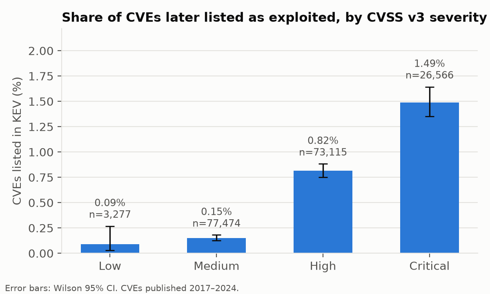
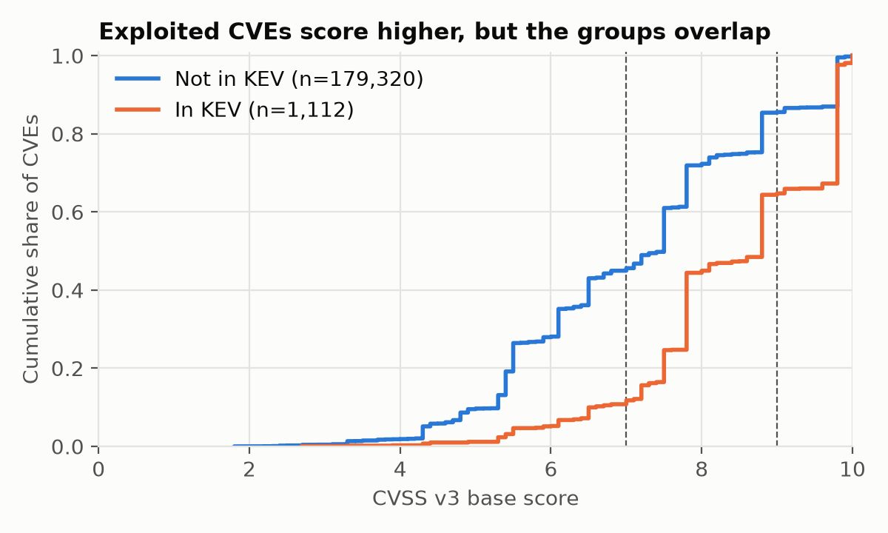
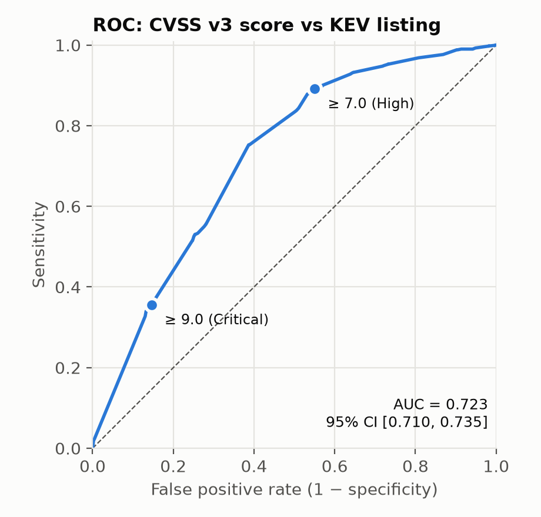
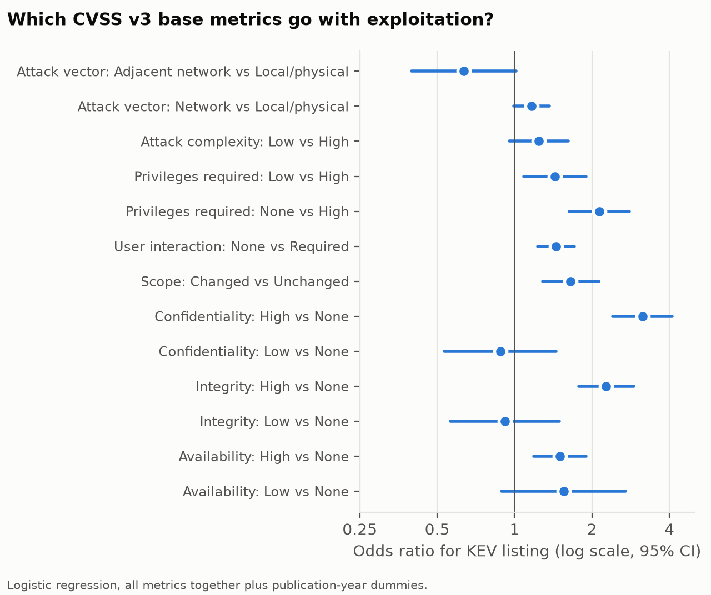

# Abstract

Many organisations decide which software vulnerabilities to patch first by their CVSS base score, for example "fix everything rated High (≥ 7.0)". Allodi and Massacci (2014) tested this practice with a case-control design borrowed from epidemiology and found that the CVSS score catches most exploited vulnerabilities but flags far too many that are never exploited. Their ground truth was Symantec attack-signature data from more than a decade ago. We replicate their analysis with current public data: 180,432 CVEs published 2017–2024 from the National Vulnerability Database (NVD), with exploitation defined as listing in CISA's Known Exploited Vulnerabilities (KEV) catalog (1,112 CVEs, 0.62%). The share of CVEs later exploited rises with severity, from 0.09% (Low) to 1.49% (Critical); χ²(3) = 667.3, p < 10⁻¹⁰⁰. The association itself is weak, however (Cramér's V = 0.061). The "≥ 7.0" rule has a sensitivity of 89.2% [95% CI 87.2–90.9] but a specificity of only 45.0% [44.7–45.2]. It flags 55% of all CVEs, and only 1 in 100 flagged CVEs is ever exploited. The original paper's CVSS v2 sensitivity replicates almost exactly (78.6% vs 78.7%), while specificity is higher than reported in 2014 (58.2% vs 44.4%). The base score's overall discrimination is modest (AUC = 0.723 [0.710–0.735]). Once the impact sub-metrics are held fixed in a matched case-control bootstrap, the advantage of a high score almost disappears (odds ratio 1.69 vs 6.55 unmatched). In a logistic regression, high confidentiality and integrity impact and "no privileges required" are the strongest predictors, while "network attack vector" is not significant once the other metrics are held fixed. The 2014 conclusion still holds: CVSS measures severity, not the likelihood of exploitation, and should not be used alone to prioritise patching.

**Keywords:** CVSS, vulnerability management, CISA KEV, exploitation, case-control study, replication, sensitivity and specificity

# 1. Introduction

The Common Vulnerability Scoring System (CVSS) gives every publicly disclosed vulnerability (CVE) a base score from 0 to 10 and a severity label: Low, Medium, High or Critical. Because the score is free, standardised and available for almost every CVE, it is widely used as a patching rule, for example "remediate all High and Critical vulnerabilities within 30 days". The number of new CVEs has grown from about 14,600 in 2017 to over 48,000 in 2025 (NVD data, this study), so the quality of that rule matters: every vulnerability patched unnecessarily costs time that could go to one that is actually attacked.

CVSS was designed to describe *how bad* a vulnerability would be if exploited, not *how likely* it is to be exploited. Allodi and Massacci (2014) asked whether, in practice, the score still works as a test for exploitation. Borrowing the case-control method used to link smoking and lung cancer, they treated "exploited in the wild" as the disease and "CVSS ≥ 6" as the diagnostic test. On NVD data, the test caught 78.7% of exploited vulnerabilities (sensitivity) but correctly cleared only 44.4% of the rest (specificity). They concluded that CVSS-only policies give little real risk reduction.

Two things have changed since then. First, CVSS v3 replaced v2, with new metrics (Scope, User Interaction, Privileges Required) and a different scale. Second, since November 2021 the U.S. Cybersecurity and Infrastructure Security Agency (CISA) has published the Known Exploited Vulnerabilities (KEV) catalog, a public, authoritative list of CVEs with confirmed exploitation. KEV gives a far more transparent ground truth than the proprietary Symantec signatures used in 2014.

This paper is a **replication** of Allodi and Massacci (2014) with current data. We do not propose a new prediction model. We ask whether their findings still hold, using statistical methods a reader can recompute from public files. Our research questions are:

- **RQ1.** Does the share of CVEs that become known-exploited differ across CVSS v3 severity levels, and how strong is that association?
- **RQ2.** How well do common CVSS thresholds (≥ 7.0 and ≥ 9.0) work as a test for exploitation (sensitivity, specificity, predictive values, odds ratios)?
- **RQ3.** Do Allodi and Massacci's 2014 sensitivity and specificity figures replicate on current data, in both their observational and case-control designs?
- **RQ4.** Which individual CVSS v3 base metrics are associated with exploitation when the others are held constant?

# 2. Related work

**The original study.** Allodi and Massacci (2014) compared the NVD, a proof-of-concept exploit database (Exploit-DB), a hand-collected list of CVEs in black-market exploit kits, and Symantec attack signatures as evidence of exploitation in the wild. Besides observational sensitivity and specificity, they ran a randomised case-control study with controls sampled to match the cases on impact and other confounders, bootstrapped 400 times. Their headline result was high sensitivity and poor specificity in every dataset.

**Exploit prediction.** The Exploit Prediction Scoring System (EPSS; Jacobs et al., 2021) was built because severity scores do not estimate the probability of exploitation; it predicts the chance of exploitation within twelve months. Tan et al. (2025) report no clear correlation between CVSS and EPSS scores. Koscinski et al. (2025) compare CVSS, SSVC, EPSS and Microsoft's Exploitability Index on 600 Patch Tuesday vulnerabilities and report that their different goals and outputs lead to inconsistent prioritisation decisions. Paul (2026) shows that evaluating EPSS with today's scores on historical CVEs leaks information about the outcome and inflates its apparent performance. This is why we leave EPSS out of our analysis (Section 3.5).

**KEV as ground truth.** Several recent studies use KEV, mostly with machine learning. Denysiuk (2025) trains a logistic regression on NVD features over 300,000 CVEs and notes that KEV is an incomplete "source of truth". Aljaafari (2026) publishes code and data for an explainable machine-learning analysis of CVSS against KEV for CVEs from 2018–2023. Gordeychik (2026) measures how many 2025 KEV additions EPSS thresholds would have caught, and when. Ancveirs (2026) describes the nine CVEs added to KEV in one week of August 2026, eight of which were Critical. Mujeye (2026) compares supply-chain and other KEV entries and finds no significant differences.

**Gap.** We found no study that reruns the Allodi and Massacci design (observational and case-control sensitivity and specificity, with their threshold) on KEV and reports the numbers side by side. That is the contribution of this paper. It is a replication and update, not a new method.

# 3. Data and methods

All steps were fixed in a written analysis plan (`ANALYSIS_PLAN.md`) before any outcome statistics were computed. The one deviation is reported in Section 3.4.

## 3.1 Data sources

| Source | Version | Content |
|---|---|---|
| NVD, via the `fkie-cad/nvd-json-data-feeds` mirror | `CVE-all.json.xz`, feed timestamp 2026-10-19 | 409,838 CVE records with CVSS v2, v3.x and v4 metrics |
| CISA KEV catalog, via `cisagov/kev-data` | downloaded 2026-10-19 | 1,748 CVEs, added between 2021-11-03 and 2026-10-16 |

All 1,748 KEV CVEs were found in the NVD file.

## 3.2 Study population

We included CVEs that (i) were published from 1 January 2017 to 31 December 2024, (ii) were not marked *Rejected*, and (iii) had a CVSS v3.x base score above 0. The 2024 cut-off gives every CVE at least about 22 months in which it could be added to KEV. For the score, we used NVD's own assessment when available and otherwise the score supplied by the reporting organisation (CNA). After 2023, NVD increasingly left CVEs unscored, so this fallback matters for recent years; a robustness check uses NVD scores only.

The final cohort contains **180,432 CVEs**, of which **1,112 (0.62%)** are in KEV. The outcome variable is *KEV* = 1 if the CVE appears in the catalog and 0 otherwise.

Severity follows the CVSS v3 bands: Low 0.1–3.9, Medium 4.0–6.9, High 7.0–8.9, Critical 9.0–10.0.

## 3.3 Statistical methods

All tests are two-sided with α = 0.05. The four main tests (H1, H2 and the two Fisher tests in H4) were corrected for multiple comparisons with the Holm method. With n = 180,432, even tiny differences are "significant", so we interpret results mainly through **effect sizes and confidence intervals**.

**H1: KEV rate by severity.** Pearson's chi-square test of independence on the 4 × 2 table of severity × KEV:

$$\chi^2 = \sum_{i,j} \frac{(O_{ij} - E_{ij})^2}{E_{ij}}, \qquad E_{ij} = \frac{R_i C_j}{n}$$

Effect size is Cramér's V = √(χ² / (n · (min(r, c) − 1))). Each category's KEV rate gets a Wilson score 95% confidence interval, which behaves well for proportions close to 0:

$$\frac{\hat p + \frac{z^2}{2n} \pm z\sqrt{\frac{\hat p(1-\hat p)}{n} + \frac{z^2}{4n^2}}}{1 + \frac{z^2}{n}}, \qquad z = 1.96$$

**H2: Score difference.** CVSS scores are bounded and not normally distributed, so we used the Mann–Whitney U test instead of a t-test. Effect size is the rank-biserial correlation r = 2U / (n₁n₀) − 1, which ranges from −1 to 1.

**H3: Diagnostic accuracy.** For a threshold t, the test is positive if score ≥ t. From the 2 × 2 table (TP, FN, FP, TN):

- Sensitivity = TP / (TP + FN): share of exploited CVEs that the rule flags.
- Specificity = TN / (TN + FP): share of non-exploited CVEs that the rule clears.
- PPV = TP / (TP + FP): chance that a flagged CVE is exploited.
- NPV = TN / (TN + FN): chance that a cleared CVE is not exploited.

Each has a Wilson 95% CI.

**H4: Odds ratio.** OR = (TP · TN) / (FP · FN), with a Woolf (log) 95% CI. Significance is tested with Fisher's exact test.

**H5: Logistic regression.** We modelled

$$\log \frac{P(\text{KEV}=1)}{1-P(\text{KEV}=1)} = \beta_0 + \sum_k \beta_k x_k + \gamma_{\text{year}}$$

with all eight CVSS v3 base metrics as categorical predictors (Attack Vector, Attack Complexity, Privileges Required, User Interaction, Scope, and Confidentiality, Integrity and Availability impact) plus publication-year dummies. Each metric's least severe level is the reference. We report odds ratios e^β with 95% CIs and McFadden's pseudo-R².

**H6: Discrimination.** The ROC AUC of the raw base score, computed as U / (n₁n₀) and equal to (1 + r) / 2, with a 95% CI from 1,000 stratified bootstrap resamples.

**Replication of Allodi and Massacci (2014).**

- *Observational:* sensitivity and specificity of their exact test, CVSS **v2** score ≥ 6, on cohort CVEs that also have a v2 score (n = 105,050; NVD stopped issuing v2 scores in 2022).
- *Case-control:* all 1,112 KEV CVEs are cases. For each bootstrap replicate (400, as in the original), cases are resampled with replacement and each is given 10 random non-KEV controls from the same stratum. Strata are either (a) publication year, or (b) publication year plus the confidentiality/integrity/availability impact triple, mirroring their "controlled by impact" design. We report the median and 2.5–97.5 percentiles of sensitivity, specificity and OR for score ≥ 7.0.

**Robustness checks (pre-specified).** We reran H1, H3, H4 and H6 on (1) NVD-scored CVEs only and (2) CVEs published 2018–2023.

## 3.4 Deviation from the plan

No CVE with attack vector *Physical* is in KEV (0 of 1,753). This "complete separation" makes the logistic model's estimate for that level infinite, so the model does not converge. We merged *Physical* into *Local* as a single reference level. Nothing else was changed.

## 3.5 Why EPSS is not included

Current EPSS scores are partly trained on exploitation evidence, including KEV, so comparing them with KEV on old CVEs leaks the answer into the predictor (Paul, 2026). A fair comparison would need EPSS scores as they stood at each CVE's publication date, which is beyond the scope of this replication.

## 3.6 Software and reproducibility

The analysis uses Python 3.14 with pandas 3.0.6, SciPy 1.18.1 and statsmodels 0.15.0. The random seed is 20261019. `extract.py` streams the NVD file into a CSV, and `analysis.py` produces every number, table and figure in this paper (`results/results.json`, `results/tables.md`, `figures/`).

# 4. Results

## 4.1 RQ1: Exploitation rate by severity

**Table 1.** Share of CVEs listed in KEV by CVSS v3 severity (2017–2024).

| Severity | CVEs | In KEV | KEV rate | 95% CI (Wilson) |
|---|---:|---:|---:|---|
| Low | 3,277 | 3 | 0.09% | 0.03–0.27% |
| Medium | 77,474 | 117 | 0.15% | 0.13–0.18% |
| High | 73,115 | 596 | 0.82% | 0.75–0.88% |
| Critical | 26,566 | 396 | 1.49% | 1.35–1.64% |
| **Total** | **180,432** | **1,112** | **0.62%** | |

The KEV rate rises steadily with severity. A Critical CVE is about 10 times as likely to be exploited as a Medium one (1.49% vs 0.15%). The association is highly significant, χ²(3) = 667.3, p < 10⁻¹⁰⁰ (Holm-adjusted), but weak: **Cramér's V = 0.061**. Even in the Critical group, 98.5% of CVEs never appear in KEV.

Exploited CVEs score higher: median 8.8 vs 7.5 (mean 8.41 vs 7.12), Mann–Whitney U = 1.44 × 10⁸, p < 10⁻¹⁰⁰. This is a medium-sized effect, rank-biserial **r = 0.445**. Figure 2 shows that the two distributions still overlap heavily: about 45% of non-exploited CVEs also score 7.0 or more.

## 4.2 RQ2: CVSS thresholds as a test for exploitation

**Table 2.** Diagnostic accuracy of two common patching thresholds. All p-values Holm-adjusted.

| Rule | Sensitivity | Specificity | PPV | NPV | Odds ratio [95% CI] | Fisher p |
|---|---|---|---|---|---|---|
| Score ≥ 7.0 (High+) | 89.2% [87.2, 90.9] | 45.0% [44.7, 45.2] | 1.00% | 99.85% | 6.75 [5.59, 8.16] | < 10⁻¹⁰⁰ |
| Score ≥ 9.0 (Critical) | 35.6% [32.9, 38.5] | 85.4% [85.2, 85.6] | 1.49% | 99.53% | 3.24 [2.86, 3.66] | < 10⁻⁶⁶ |

The **≥ 7.0 rule** catches 89% of exploited CVEs, but it flags 99,681 CVEs (55.2% of the cohort) to do so. Of those, 992 are exploited, so a team would patch about **100 vulnerabilities for every one that is actually attacked** (PPV = 1.00%). The **≥ 9.0 rule** reduces the workload to 14.7% of CVEs but misses almost two thirds (64.4%) of exploited ones, while the PPV only improves to 1.49%.

Across all thresholds, the AUC is **0.723 [0.710, 0.735]** (Figure 3). That is better than chance (0.5) but well below the 0.8–0.9 usually expected of a useful screening test.

## 4.3 RQ3: Replication of Allodi and Massacci (2014)

**Table 3.** Observational replication with the original test (CVSS v2 ≥ 6).

| Study | Exploitation ground truth | Sensitivity | Specificity |
|---|---|---|---|
| Allodi & Massacci (2014), NVD | Symantec attack signatures | 78.7% | 44.4% |
| This study (n = 105,050; 735 in KEV) | CISA KEV | **78.6%** [75.5, 81.4] | **58.2%** [57.9, 58.5] |

Sensitivity replicates almost exactly; the original value lies well inside our 95% CI. Specificity is about 14 percentage points higher than in 2014: on today's data, CVSS v2 clears more of the never-exploited vulnerabilities. Even so, 42% of non-exploited CVEs would still be flagged.

**Table 4.** Case-control bootstrap for score ≥ 7.0 (1,112 cases, 10 controls per case, 400 resamples; median [2.5th, 97.5th percentile]).

| Controls matched on | Sensitivity | Specificity | Odds ratio |
|---|---|---|---|
| Publication year | 89.1% [87.4, 91.0] | 44.6% [43.5, 45.4] | 6.55 [5.42, 7.94] |
| Publication year + C/I/A impact | 89.3% [87.1, 90.8] | **17.0%** [15.2, 18.6] | **1.69** [1.49, 1.92] |

Matching on year alone gives the same results as the full cohort, so the trend over time does not drive the findings. Matching on impact as well gives the key result. When exploited and non-exploited CVEs have the **same impact profile**, almost all controls also score ≥ 7.0: specificity drops to 17%, and the odds ratio falls from 6.55 to 1.69. This reproduces the pattern Allodi and Massacci found in their impact-controlled sample (specificity 23–32%). Most of what the CVSS score "knows" about exploitation comes from the impact metrics. The exploitability part of the score adds little.

## 4.4 RQ4: Which metrics matter?

**Table 5.** Logistic regression of KEV listing on all CVSS v3 base metrics plus publication year (n = 180,432; McFadden pseudo-R² = 0.069; likelihood-ratio test p < 10⁻¹⁰⁰).

| Metric | Level vs reference | OR [95% CI] | p |
|---|---|---|---|
| Attack vector | Network vs Local/Physical | 1.17 [1.00, 1.37] | 0.058 |
| Attack vector | Adjacent vs Local/Physical | 0.63 [0.40, 1.01] | 0.056 |
| Attack complexity | Low vs High | 1.24 [0.96, 1.61] | 0.10 |
| Privileges required | Low vs High | 1.43 [1.09, 1.89] | 0.011 |
| Privileges required | None vs High | **2.14** [1.63, 2.79] | < 0.001 |
| User interaction | None vs Required | 1.45 [1.23, 1.71] | < 0.001 |
| Scope | Changed vs Unchanged | 1.65 [1.28, 2.12] | < 0.001 |
| Confidentiality | High vs None | **3.14** [2.41, 4.10] | < 0.001 |
| Confidentiality | Low vs None | 0.88 [0.53, 1.45] | 0.62 |
| Integrity | High vs None | **2.27** [1.77, 2.91] | < 0.001 |
| Integrity | Low vs None | 0.91 [0.56, 1.49] | 0.72 |
| Availability | High vs None | 1.50 [1.19, 1.90] | < 0.001 |
| Availability | Low vs None | 1.55 [0.89, 2.70] | 0.12 |

Holding the other metrics fixed, the strongest predictors of exploitation are **High confidentiality impact** (OR 3.14), **High integrity impact** (OR 2.27) and **no privileges required** (OR 2.14). Only the *High* levels of impact matter; *Low* impact is no different from *None*. Surprisingly, a *network* attack vector is not significantly associated with exploitation once the other metrics are included (OR 1.17, p = 0.058), and neither is low attack complexity (p = 0.10). Together, the eight metrics explain very little of the variation (pseudo-R² = 0.069), which agrees with the modest AUC.

## 4.5 Robustness

**Table 6.** Main results under the two pre-specified robustness checks.

| Cohort | n | KEV | Cramér's V | Sens. ≥ 7 | Spec. ≥ 7 | OR ≥ 7 | AUC |
|---|---:|---:|---:|---|---|---|---|
| Main (2017–2024, NVD or CNA score) | 180,432 | 1,112 | 0.061 | 89.2% | 45.0% | 6.75 | 0.723 |
| NVD-scored only | 159,044 | 1,015 | 0.062 | 89.1% | 44.3% | 6.47 | 0.722 |
| 2018–2023 only | 126,162 | 863 | 0.059 | 88.4% | 43.4% | 5.86 | 0.711 |

The results barely change, so the conclusions do not depend on where the scores come from or on the exact years included.

# 5. Discussion

**The 2014 conclusion still holds.** Twelve years, a new CVSS version and a different source of exploitation data later, the picture is the same: CVSS is a sensitive but very unspecific test for exploitation. The near-identical v2 sensitivity (78.6% vs 78.7%) is notable because the two studies share no exploitation data at all. The higher specificity we observe may reflect KEV's stricter definition of exploitation, changes in how scores are assigned, or both. Our design cannot separate these explanations.

**Why the score is a weak predictor.** CVSS v3 scores cluster heavily: six values (9.8, 7.5, 7.8, 8.8, 5.5 and 6.1) account for 59% of all CVEs in the cohort (the steps in Figure 2). A score therefore puts a CVE into one of a few broad buckets rather than ranking it. The impact-matched case-control result (OR 1.69) and the logistic regression both show that the useful signal sits mainly in the confidentiality, integrity and privilege metrics. The parts of the score meant to describe how easy an attack is (attack vector, attack complexity) add little once those are known. One likely reason is that attackers choose targets by factors CVSS does not measure, such as how widely a product is deployed and whether it is exposed on the internet. The KEV catalog itself is concentrated: Microsoft alone accounts for 22.3% of its 1,748 entries, and the top 10 of 289 vendors for 53.1%.

**Practical implication.** A "patch everything ≥ 7.0" policy is safe in one sense: it leaves only 0.15% exploited CVEs among those it clears (NPV 99.85%). But it costs about 100 patches per exploited vulnerability caught and still misses 11% of exploited ones. Raising the bar to ≥ 9.0 cuts the work by three quarters but misses most exploited CVEs. In line with the literature reviewed in Section 2, these numbers support using CVSS for *impact* together with a separate exploitation signal, such as KEV itself, EPSS or vendor threat intelligence, rather than as a forecast.

# 6. Limitations

1. **KEV underestimates exploitation.** It lists only exploitation that CISA has confirmed and that has a clear fix. Some "controls" are exploited without being in KEV, which lowers the measured PPV and specificity. Our results describe CVSS against *confirmed, catalogued* exploitation, not all exploitation.
2. **KEV selection bias.** CISA focuses on vulnerabilities relevant to U.S. federal systems. Products used mainly elsewhere, or mainly by consumers, may be under-represented.
3. **Possible look-ahead in scores.** We used each CVE's current CVSS score. If NVD or vendors re-scored a CVE after exploitation became known, the score could be inflated for KEV cases, which would make CVSS look *better* than it is in real time. Our conclusion that CVSS is a weak predictor is therefore, if anything, conservative.
4. **Different time to follow-up.** A CVE from 2017 has had longer to be added to KEV than one from 2024. Year dummies (H5), year-matched controls (Table 4) and the 2018–2023 subset (Table 6) all address this, and none changes the conclusions.
5. **Observational data.** These are associations, not causes. A high score does not make a vulnerability attractive to attackers; both may reflect the same underlying features.
6. **Literature coverage.** The related-work search used OpenAlex, arXiv, Crossref, Semantic Scholar and Zenodo. Several of the 2025–2026 studies were read only as abstracts, and OpenAlex and Semantic Scholar were intermittently unavailable or rate-limited during the search, so a closely related study may have been missed.

# 7. Conclusion

Using 180,432 CVEs and the CISA KEV catalog, we replicated Allodi and Massacci's (2014) evaluation of CVSS as a test for exploitation. Higher severity is associated with a higher chance of exploitation (from 0.09% for Low to 1.49% for Critical), but the association is weak (Cramér's V = 0.061; AUC = 0.72). The common "≥ 7.0" patching rule catches 89% of known-exploited vulnerabilities at the cost of flagging more than half of all CVEs, about 100 for each exploited one. The 2014 sensitivity replicates almost exactly, and once impact is held fixed the score's predictive value nearly vanishes. CVSS describes how bad a vulnerability could be, not whether it will be exploited, and patching policies should treat these as two separate questions.

# References

Aljaafari, M. A. H. (2026). *Replication package for: Severity is not exploitation: An explainable machine learning analysis of CVSS scores and known exploited vulnerabilities* [Data set]. Zenodo. https://doi.org/10.5281/zenodo.23401129

Allodi, L., & Massacci, F. (2014). Comparing vulnerability severity and exploits using case-control studies. *ACM Transactions on Information and System Security.* https://doi.org/10.1145/2630069

Ancveirs, Z. (2026). When severity and exploitation signals diverge: A cross-sectional study of CISA Known Exploited Vulnerabilities. *SSRN Electronic Journal.* https://doi.org/10.2139/ssrn.7355200

Denysiuk, V. (2025). Predicting CVE exploitation based on NVD and KEV open data for risk-oriented prioritization. *Cybersecurity: Education, Science, Technique.* https://doi.org/10.28925/2663-4023.2025.30.906

Gordeychik, S. (2026). *Prediction meets patch queues: Empirical limits of EPSS-only prioritization using CISA KEV additions in 2025* [Preprint]. TechRxiv. https://doi.org/10.36227/techrxiv.176857939.95987957/v1

Jacobs, J., Romanosky, S., Edwards, B., Adjerid, I., & Roytman, M. (2021). Exploit Prediction Scoring System (EPSS). *Digital Threats: Research and Practice.* https://doi.org/10.1145/3436242

Koscinski, V., Nelson, M., Okutan, A., Falso, R., & Mirakhorli, M. T. (2025). Conflicting scores, confusing signals: An empirical study of vulnerability scoring systems. In *Proceedings of the ACM SIGSAC Conference on Computer and Communications Security (CCS).* https://doi.org/10.1145/3719027.3765210

Mujeye, S. (2026). Severity impact discrepancy in supply chain vulnerabilities: An empirical analysis using the CISA Known Exploited Vulnerabilities (KEV) database. In *Proceedings of the International Conference on Software Engineering and Information Management (ICSIM).* https://doi.org/10.1145/3796315.3796349

Paul, S. (2026). *How good is EPSS, really? A five-year empirical evaluation correcting for look-ahead bias* [Data set]. IEEE DataPort. https://doi.org/10.21227/bhhs-0994

Tan, E. H., Unal, I. E., Rhea, S., & Tatar, U. (2025). Analysis of vulnerability severity and exploit probability scoring frameworks: CVSS and EPSS. In *Systems and Information Engineering Design Symposium (SIEDS).* https://doi.org/10.1109/sieds65500.2025.11021216

**Data.** CISA, *Known Exploited Vulnerabilities Catalog*, https://github.com/cisagov/kev-data (downloaded 2026-10-19). NIST, *National Vulnerability Database*, via https://github.com/fkie-cad/nvd-json-data-feeds (feed of 2026-10-19).
